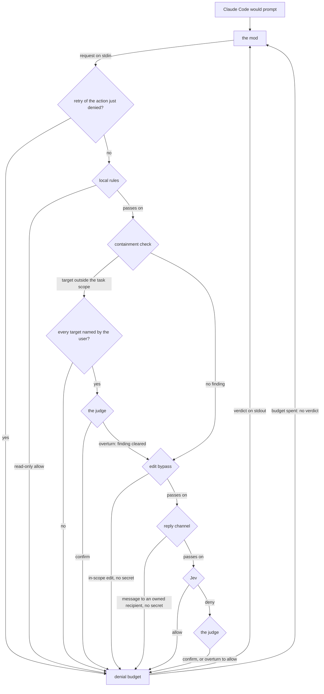
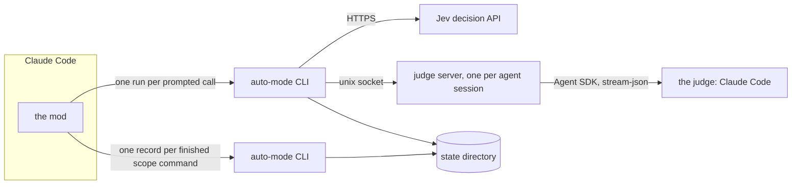

# Architecture overview

auto-mode answers the permission prompts Claude Code would show while an agent works unattended.
When Claude Code is about to ask the user about a tool call, the auto-mode mod runs the auto-mode
CLI once for that call, and the CLI writes back an allow, a deny with a reason, or no verdict at
all. An allow lets the call run, and a deny reaches the agent as the tool's result, so the agent
continues on another path. No verdict makes the mod keep the prompt Claude Code was about to show,
so the user decides. The design aims at a model other than Claude driving Claude Code, which gets no
judging of its own; [the product README](../../README.md) covers what auto-mode is for.

Every call the CLI judges passes through deterministic checks first, and only what they leave open
reaches Jev, a classifier from TypeSafe that answers typed questions over its decision API. A second
model, the judge, reviews every deny Jev gives, unless the configuration turns the judge off. The
denial budget sits after all of them and is the only path from a deny to a human: an agent that
keeps getting denied is eventually handed back to the user.

## The path of a prompted call

1. The mod builds a request from the pending call: the session identity, the tool and its input, the
   current directory, and the task context, which includes the last message the user typed. It hands
   the request to the CLI on stdin ([the mod](./mod.md)).
2. The denial budget checks first whether the call repeats the action it just denied. A repeat gets
   the same deny again, without asking any model, so a classifier that answers differently on each
   sample cannot be asked until it allows ([the denial budget](./stages/denial-budget.md)).
3. The local rules allow read-only tools and read-only shell commands on sight, and pass every other
   call on ([local rules](./stages/local-rules.md)).
4. The containment check reads the write targets it can resolve from the call and denies any that
   lies outside the task scope: the worktrees, paths, branches and pull requests the task owns
   ([containment](./stages/containment.md), [the task scope](./evidence/task-scope.md)). When the
   user's last message names every target, the call moves on with the deny pending, and the judge
   reviews it beside any Jev deny
   ([the user-named grant](./stages/containment.md#the-user-named-grant)).
5. The edit bypass allows a file edit inside a worktree the task owns, once a secret scan of the new
   content finds nothing ([the edit bypass](./stages/edit-bypass.md)).
6. The reply channel allows a message to a recipient the session's launcher declared as the
   session's own, once a secret scan of the message finds nothing
   ([the reply channel](./stages/reply-channel.md)).
7. Jev answers one question per block rule in the policy, and the CLI denies when any rule's block
   probability reaches the configured threshold ([Jev](./stages/jev.md)).
8. The judge, when configured, reads every deny of the call in one review: the pending containment
   deny and the Jev deny. It confirms each with a written reason, or overturns it when the user's
   last message asked for exactly this action or when no rule covers the action. The call is allowed
   only when every deny is overturned ([the judge](./stages/judge.md)).
9. The denial budget counts each deny. The deny that would pass the budget becomes no verdict, so
   that call reaches the user.

The first stage that decides ends the path. One exception: a local allow for deleting regenerable
build output waits until the containment check has passed, because it deletes files, while a
read-only allow returns before the task scope even loads.

## Topology

The mod runs inside Claude Code, which loads it as raw TypeScript from the plugin directory, and
holds what it knows about the session in memory. It starts the CLI as a short-lived child process
for every call it judges and kills it at its own time limit, so a hung classifier costs one prompt,
never the session. After a Bash call that can create a worktree, a branch or a pull request
finishes, the mod starts the CLI a second time to record what the call made.

The CLI is the published `auto-mode` package, built for node, and each run ends with the call it
judges. It reaches Jev over HTTPS. It reaches the judge through a judge server: a detached CLI
process, one per agent session, that holds a Claude Code process warm between prompted calls and
ends after a stretch with no review. The first run that needs the judge starts the server, so only
the first review of a session pays the start of Claude Code. Jev is the only classifier the
configuration accepts.

## Data

auto-mode owns no database. Every file it writes lives in its state directory, and every file it
reads elsewhere belongs to someone else:

- **The configuration file** holds the choice of classifier, the judge, the scope sources, the
  denial budget and the opt-in capture. A missing file means the shipped defaults
  ([configuration](../guides/configuration.md)).
- **The policy** is the set of Markdown files under `policy/` that the classifiers read verbatim:
  the rule list and one framework per model ([the policy](./policy.md)).
- **The denial counts** keep one small file per session and subagent, so the budget survives a
  reload of the mod and a resumed session.
- **The session scope** keeps one file per session listing what that session's own calls created,
  which the task scope reads back.
- **The launcher scope file** is the file a program that starts the session writes in a format
  auto-mode defines, listing what the session owns. auto-mode reads it and never writes it
  ([declaring a session's scope](../guides/scope-file.md)).
- **The action log** appends one line per judged call, with the deciding stage and the counts, and
  the opt-in capture appends each full request ([state and logs](./state-and-logs.md)).
- **Claude Code's settings and configuration** supply the user's own block rules and the configured
  MCP servers. auto-mode reads them and never writes them
  ([settings and repository facts](./evidence/settings-and-repository.md)).

## Cross-cutting rules

- **A run always exits zero.** The mod reads a non-zero exit as a broken CLI and keeps the prompt,
  so the JSON on stdout alone decides the outcome, and a CLI that cannot start at all costs the user
  one prompt.
- **No verdict is an answer.** It means auto-mode has no opinion, and the mod keeps the prompt. A
  body that is not a request, a configuration the CLI cannot read, a classifier failure under the
  default failure response, and the call that spends the denial budget all end in no verdict. The
  classifiers themselves never ask: each answers allow or deny.
- **A failure defers or denies.** When Jev cannot answer, the configured failure response either
  defers, which writes no verdict, or denies as `Classifier Unavailable`. The judge always fails
  closed: a judge that cannot answer keeps the deny.
- **Every deny carries a reason the agent can act on.** The reason holds the rule's name in
  brackets, then the harm the rule covers and what would clear it, and it ends with the shipped
  instruction not to reach the same result another way.
- **The contract is strict on both sides.** The CLI and the mod ship together, so each refuses a
  shape it does not know, and a refused shape keeps the prompt.
- **auto-mode reads no transcript.** The only conversation it sees is the task context the mod puts
  in the request ([the user message](./evidence/user-message.md)).
