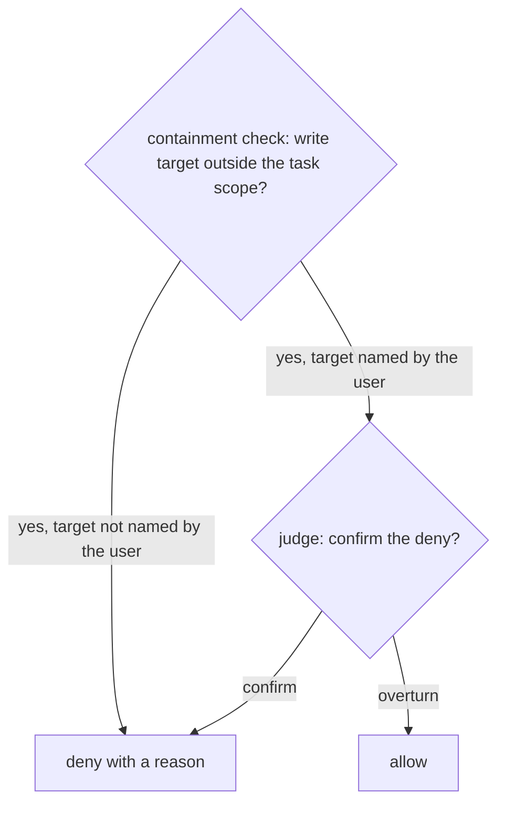

# Decision model: the unbuilt parts

The decision model is the approved design for what each stage of auto-mode decides. Most of it is
built, and [the architecture overview](../../architecture/overview.md) describes the built stages.
This design holds only the parts the code does not implement. The decision records hold the reasons,
the evidence and the rejected alternatives: the
[decision model record](https://linear.app/zgeoff/document/geo-100-decision-record-auto-mode-decision-model-4c00fccbe287)
and the
[evaluation toolset record](https://linear.app/zgeoff/document/geo-88-decision-record-auto-mode-evaluation-toolset-eb866dbc021e).

## The user-named grant

The containment check denies every write target outside the task scope, and nothing clears its deny.
The design adds one source of scope that is decided per call: when the last direct user message
contains the exact target, such as a path, a branch name or a pull request number, the containment
check hands the call to the judge instead of denying it.

The judge allows the call only when the user, in that message, asks for this action (write, delete,
merge) on this target. A name alone is not consent: "port the formatter from the export-csv
worktree" names a source to read, not a target to write. The grant never covers the default branch,
a protected branch, or an `--admin` merge.

## Protected branches

No scope source can hand a task the default branch, and when the default branch is unknown, the
conventional default names stand in for it. The design widens that to every protected branch of the
repository, so a task can never own a branch the forge protects, whatever its name.

## Benign denials on real traffic

Measurement 2 counts benign denials per action, and the design takes it from a replay of recorded
real traffic from more than one repository, through every stage. The containment replay produces it
for the containment stage and for recorded Jev answers, so the judge's share of benign denials on
real traffic is unbuilt. Jev's threshold, the denial budget defaults and any release bar are set
from the measurements once each one exists.
